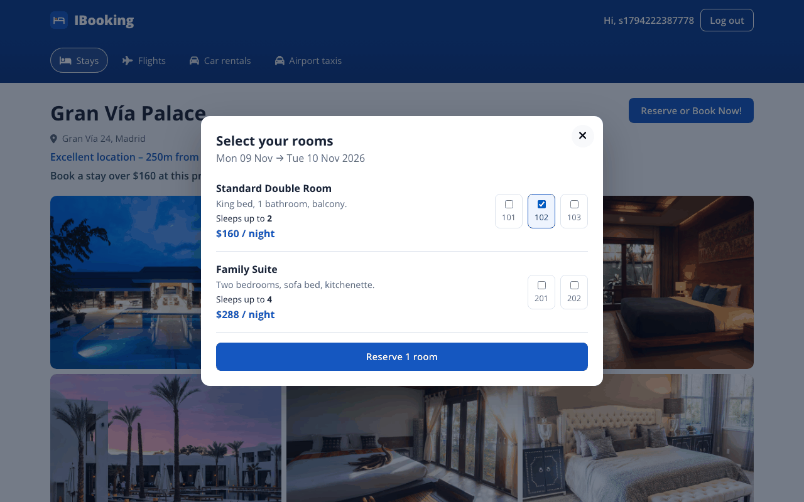

# IBooking

A hotel booking web app with a React frontend and an Express + MongoDB REST API for hotels, rooms and users.


[](https://github.com/VamsiKrishnaThota03/IBooking/actions/workflows/ci.yml)
[](https://github.com/VamsiKrishnaThota03/IBooking/actions/workflows/codeql.yml)
[](LICENSE)

| Home | Reserving rooms | Mobile |
| ---- | --------------- | ------ |
|  |  |  |

## Overview

IBooking is a learning project modelled on hotel booking sites. Users search for stays by destination, dates and number of guests, browse the results, open a hotel's detail page and reserve rooms. The backend is a REST API built on Express and Mongoose with JWT-based authentication and admin-only routes for managing hotels and rooms.

## Features

- **Search**: pick a destination, a date range (`react-date-range`) and the number of adults, children and rooms. The search is shared through a React context, so results and hotel pages also work when opened directly.
- **Home page sections**: trending cities (Berlin, Madrid, London) with live property counts, property counts by type (hotel, apartment, resort, villa, cabin), featured properties and a newsletter banner.
- **Results list**: filter hotels by city (case-insensitive) and min/max price, with loading, empty and error states.
- **Hotel detail page**: photo grid with a full-screen viewer (arrow keys and Escape work), description, total price for the selected nights and rooms, and a reservation modal.
- **Reservations**: logged-in users pick room numbers; booked dates are saved to each room number's `unavailableDates`, and rooms already booked for the chosen dates are disabled. Double bookings are rejected by the API.
- **Accounts**: register and sign in with bcrypt-hashed passwords. Login returns a JWT (7-day expiry) that the frontend keeps in an auth context backed by `localStorage`.
- **Role-based access**: admins can create, update and delete hotels and rooms and list users. Users can read, update or delete only their own account.
- **Seed script** with 8 sample properties, rooms and an optional admin user.

## Tech stack

| Layer    | Technology                                                                     |
| -------- | ------------------------------------------------------------------------------ |
| Frontend | React 18, React Router 6, Context API + `useReducer`, Font Awesome, react-date-range, date-fns, plain CSS |
| Backend  | Node.js, Express 4, Mongoose 8, bcrypt, jsonwebtoken, cors, dotenv             |
| Database | MongoDB                                                                        |

## Project structure

```
IBooking/
├── backend/
│   ├── api/            # auth, users, hotels, rooms routers
│   ├── middleware/     # verifyToken / verifyUser / verifyAdmin
│   ├── models/         # Hotel, Room, User (Mongoose schemas)
│   ├── utils/error.js  # async route wrapper
│   ├── config.js       # environment variables
│   ├── db.js           # MongoDB connection
│   ├── seed.js         # sample data
│   └── index.js        # Express entry point
├── public/
└── src/
    ├── api.js          # API base URL and fetch helper
    ├── components/     # navbar, header (search), featured, propertyList, reserve, status, ...
    ├── context/        # AuthContext, SearchContext
    ├── hooks/useFetch.js
    └── pages/          # Home, List, Hotel, Login, Register, NotFound
```

## Getting started

### Prerequisites

- Node.js 18 or later and npm
- MongoDB running locally (default `mongodb://127.0.0.1:27017/IBookingdb`) or a MongoDB Atlas URI

### Install

```bash
git clone https://github.com/VamsiKrishnaThota03/IBooking.git
cd IBooking
npm install                     # frontend dependencies
npm --prefix backend install    # backend dependencies
cp backend/.env.example backend/.env   # then set JWT_SECRET (and the others if needed)
```

### Load sample data (optional)

```bash
# also creates an admin user if SEED_ADMIN_USERNAME and SEED_ADMIN_PASSWORD are set in backend/.env
npm --prefix backend run seed
```

The seed script replaces all hotels and rooms in the database.

### Run

```bash
npm run both        # API on http://localhost:5000 and the React app on http://localhost:3000
# or separately:
npm run server      # backend with nodemon
npm start           # frontend
```

In development the CRA proxy forwards `/api/*` to `http://localhost:5000`. For a production build, set `REACT_APP_API_URL` to the deployed API origin before `npm run build`.

Other scripts: `npm run build` and `npm test`.

## Environment variables

Backend (`backend/.env`, see `backend/.env.example`):

| Variable              | Required | Description                                                         |
| --------------------- | -------- | ------------------------------------------------------------------- |
| `JWT_SECRET`          | yes      | Long random string used to sign login tokens                        |
| `MONGO_URI`           | no       | MongoDB connection string (default `mongodb://127.0.0.1:27017/IBookingdb`) |
| `PORT`                | no       | API port (default `5000`)                                           |
| `HOST`                | no       | Bind address (default `127.0.0.1`; set `0.0.0.0` on Render or similar hosts) |
| `CORS_ORIGIN`         | no       | Comma-separated allowed browser origins (default `http://localhost:3000`) |
| `SEED_ADMIN_USERNAME` | no       | Admin username created by `npm run seed`                            |
| `SEED_ADMIN_PASSWORD` | no       | Password for that admin                                             |

Frontend (`.env` in the project root, see `.env.example`):

| Variable            | Required        | Description                                         |
| ------------------- | --------------- | --------------------------------------------------- |
| `REACT_APP_API_URL` | production only | Backend origin, e.g. `https://your-api.example.com` |

## API

Protected routes expect the JWT in an `auth-token` header (or `Authorization: Bearer <token>`).

| Method | Path                                 | Access | Purpose                                                        |
| ------ | ------------------------------------ | ------ | -------------------------------------------------------------- |
| POST   | `/api/auth/register`                 | Public | Register a user (`username`, `email`, `password`, `country`, `city`, `phone`) |
| POST   | `/api/auth/login`                    | Public | Log in and receive a JWT (`authtoken`) and the user profile    |
| GET    | `/api/users`                         | Admin  | List all users (without password hashes)                       |
| GET    | `/api/users/:id`                     | Self/Admin | Get a user                                                 |
| PUT    | `/api/users/:id`                     | Self/Admin | Update profile fields (cannot change `isAdmin`)            |
| DELETE | `/api/users/:id`                     | Self/Admin | Delete a user                                              |
| POST   | `/api/hotels`                        | Admin  | Create a hotel                                                 |
| PUT    | `/api/hotels/:id`                    | Admin  | Update a hotel                                                 |
| DELETE | `/api/hotels/:id`                    | Admin  | Delete a hotel                                                 |
| GET    | `/api/hotels/find/:id`               | Public | Get a hotel by id                                              |
| GET    | `/api/hotels`                        | Public | List hotels (query: `city`, `type`, `featured`, `min`, `max`, `limit`) |
| GET    | `/api/hotels/countByCity?cities=a,b` | Public | Count hotels for each city                                     |
| GET    | `/api/hotels/countByType`            | Public | Count properties by type                                       |
| GET    | `/api/hotels/room/:id`               | Public | List the rooms of a hotel                                      |
| POST   | `/api/rooms/:hotelid`                | Admin  | Create a room and attach it to a hotel                         |
| PUT    | `/api/rooms/availability/:id`        | User   | Reserve dates for a room number (`{ dates: [...] }`, rejects overlaps) |
| PUT    | `/api/rooms/:id`                     | Admin  | Update a room                                                  |
| DELETE | `/api/rooms/:id/:hotelid`            | Admin  | Delete a room and detach it from its hotel                     |
| GET    | `/api/rooms/:id`                     | Public | Get a room                                                     |
| GET    | `/api/rooms`                         | Public | List all rooms                                                 |
| GET    | `/api/health`                        | Public | Health check                                                   |

## Known limitations

- There is no admin dashboard in the frontend; hotels and rooms are managed through the API (or the seed script).
- Reservations only mark dates as unavailable. There are no booking records, payments or cancellations, and users can't see their reservations.
- The Flights, Car rentals and Airport taxis tabs and the newsletter form are visual only.
- The JWT is stored in `localStorage`.
- `npm audit` still reports issues in Create React App's build tooling (`react-scripts` 5) that need a breaking upgrade.


## Authorization model

Three tiers, in `backend/middleware/verifyToken.js`:

| Guard | Allows |
| --- | --- |
| `verifyToken` | Any caller with a valid JWT (`auth-token` header, or `Authorization: Bearer`) |
| `verifyUser` | The account owner **or** an admin — used on `/api/users/:id` |
| `verifyAdmin` | Admins only — every hotel and room write, and listing all users |

Hotel and room **reads** are deliberately anonymous: this is a public booking
site, and gating the listings would hide the thing the app exists to show.

`isAdmin` is never read from a request body. The register route builds its own
field list, so posting `{"isAdmin": true}` creates an ordinary account — there
is a test against real MongoDB asserting exactly that.

A non-admin hitting an admin route gets **403, not 401**. The distinction
matters: the token is valid, the caller simply is not an admin, and answering
401 would wrongly suggest that re-authenticating helps.

## Hardening

The backend is split into `app.js` (the Express application) and `index.js`
(connect, bind, shut down), so tests can drive it on an ephemeral loopback port.

- **helmet** with a deny-all CSP (this is a JSON API; nothing is ever loaded
  from it as a subresource), `nosniff` and `no-referrer`.
- **Rate limiting**: a global ceiling, plus a tighter limiter on `/api/auth`
  keyed on IP **plus the submitted username**, so one attacker behind a shared
  address cannot lock out everyone else. Successes count as well as failures,
  so a valid login cannot refill the budget. Public hotel reads are
  deliberately *not* behind it, and a test asserts that. `trust proxy` is set
  to exactly one hop, so `X-Forwarded-For` cannot be spoofed to bypass it.
- **Split health probes.** `GET /api/health` is liveness and never touches
  Mongo, so a database blip cannot cause a restart loop.
  `GET /api/health/ready` reports Mongoose's connection state and answers 503
  with `Retry-After`.
- **Graceful shutdown** on SIGTERM/SIGINT that drains requests then closes Mongo.
- Malformed JSON now returns 400 and an oversized body 413, both as JSON.

## Tests

| Suite | Needs a database? | Covers |
| --- | --- | --- |
| `backend/test/api.test.js` | No | 401 vs 403 across every guarded route; wrong-key and `alg=none` token rejection; that a `Bearer` header is accepted too; that a user cannot act on another id; full register validation; the auth limiter firing and keying per username; public reads staying unlimited; JSON 404, 400 and 413 |
| `backend/test/authorization.test.js` | Yes, skips without `TEST_MONGO_URI` | Real-record authorization: a user can read their own account but not another's, cannot edit or delete another (verified untouched afterwards), an admin can list users while an ordinary user cannot, only an admin can create a hotel, a bcrypt hash is persisted rather than plaintext, and `{"isAdmin": true}` in the body does not create an admin |

```bash
cd backend
npm test                                                           # 17 tests, no database
TEST_MONGO_URI=mongodb://127.0.0.1:27017/ibooking_test npm test     # adds 11 more
```

## Continuous integration

| Job | What it proves |
| --- | --- |
| `backend` (Node 20, 22) | The no-database suite |
| `authorization` | The full suite against a MongoDB 7 service container, with coverage |
| `bind-address` | Reads `ss -ltn` on the running server: no `0.0.0.0:5000` listener by default, a loopback one present, readiness green, public listings readable anonymously while an anonymous hotel POST gets 401, clean `SIGTERM`, and `HOST=0.0.0.0` still honoured |
| `frontend` | Jest + Testing Library tests and a production build |
| `docker` | The image builds and refuses to start without `JWT_SECRET` |

CodeQL runs weekly and on every push; Dependabot groups weekly patch/minor
bumps per package.

## Docker

```bash
printf 'MONGO_PASSWORD=%s\nJWT_SECRET=%s\n' \
  "$(openssl rand -hex 16)" "$(openssl rand -hex 32)" > .env

docker compose up --build
docker compose exec api node seed.js   # sample hotels and rooms
```

MongoDB and the API both publish to `127.0.0.1` only, so neither is reachable
from your network, and Compose fails fast with a named error if either variable
is missing.

## Known limitations

- Rate limit counters live in process memory, so the ceilings are per instance.
  Scaling past one would need a shared store (Redis).
- There is no payment step; "reserve" marks the room's dates unavailable.
- `isAdmin` can only be set directly in the database, which is deliberate —
  there is no self-service path to admin.
